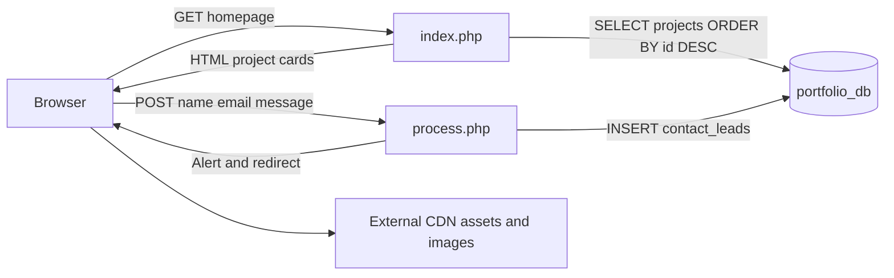

# Architecture

## Overview

The application uses server-rendered PHP with a MySQL database and a browser-based interface. There is no separate frontend build or REST API server.

## Components

| Layer | Responsibility |
|---|---|
| Presentation | HTML, inline CSS, Bootstrap, icons, AOS and external assets |
| Homepage logic | MySQLi connection, project query, title-based image selection and card rendering |
| Contact handler | Checks POST method, escapes submitted fields, inserts contact record and returns success alert or error |
| Database | Stores project metadata and contact messages |
| Static resource | Resume.pdf |

## Data flow

1. Browser requests `index.php`.
2. PHP retrieves projects from `portfolio_db` and renders HTML.
3. Browser displays the page and loads external resources.
4. Visitor submits the contact form to `process.php`.
5. PHP inserts the enquiry and redirects after success.

`process.php` also performs a project SELECT query that is not used in its contact-handling flow.

## Database contract

`projects`: id, title, github_link, tech_stack. `contact_leads`: name, email, message. Actual column types and constraints were not supplied.

## Configuration and future improvements

Both PHP files currently configure MySQL directly. The environment template is a future configuration guide, not an active loader. Before deployment, centralize configuration, use prepared statements, escape output and improve error handling. No production authentication or admin interface is present in the supplied files.
