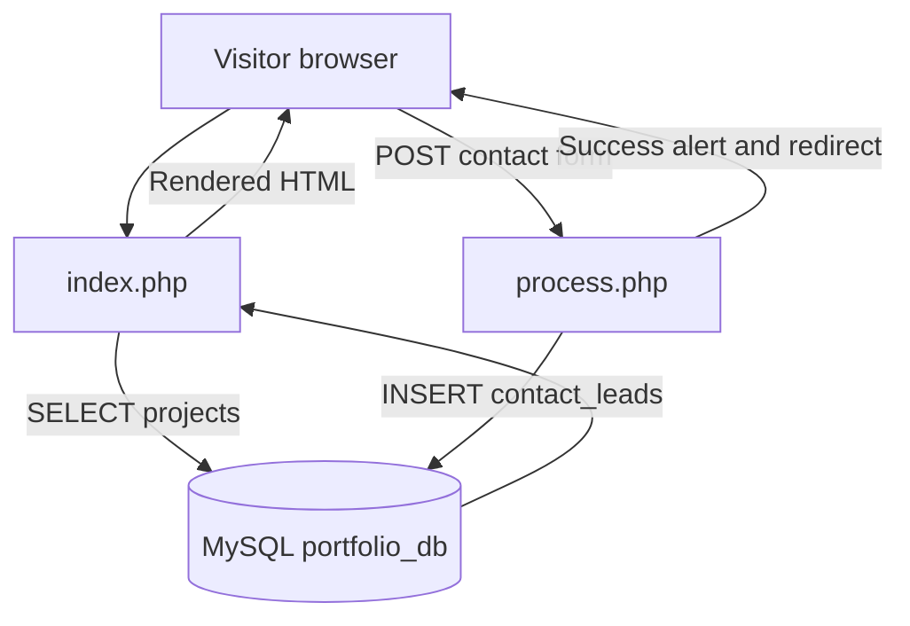

# Personal Portfolio Website

A dynamic personal portfolio for showcasing technical skills, software projects and internship availability. Built with PHP, MySQL and Bootstrap, it retrieves project information from a database and stores visitor enquiries through a contact form.

## Features

- Responsive navigation and landing section with internship availability.
- About section and categorized technical skills.
- Dynamic project cards displaying titles, technology stacks and GitHub links, newest IDs first.
- Project images selected according to project titles, with a default image.
- Downloadable resume (`Resume.pdf`).
- Contact form with name, email and message fields; submissions are stored in MySQL.
- Success alert and redirect to the homepage after a successful submission.
- Email, LinkedIn and GitHub links.
- Scroll animations, icons and decorative developer-themed interface.

## Technology stack

| Technology | Purpose |
|---|---|
| HTML5, CSS3 | Page structure and styling |
| JavaScript | Browser interactions and animations |
| Bootstrap 5.3 | Responsive layout and components |
| PHP | Server-side rendering and form handling |
| MySQL / MySQLi | Project retrieval and contact storage |
| AOS 2.3.1 | Scroll animations |
| Bootstrap Icons, Google Fonts | Icons and typography |
| dotLottie player | Animation component loaded by the page |
| XAMPP | Suggested local Apache and MySQL environment |

## Project structure

```text
portfolio/
├── index.php       # Homepage, database query and project cards
├── process.php     # Contact form processing
└── Resume.pdf      # Downloadable resume
```

See [PROJECT_STRUCTURE.md](PROJECT_STRUCTURE.md) for details.

## Architecture



## Local installation

1. Install XAMPP (or another PHP and MySQL environment).
2. Clone or download this repository into `C:/xampp/htdocs/portfolio`.
3. Start Apache and MySQL in the XAMPP Control Panel.
4. Open `http://localhost/phpmyadmin` and create the `portfolio_db` database.
5. Import your existing database backup if available. Otherwise, the following example creates the minimum fields required by the supplied PHP code. It is a proposed schema, not an export of the original database.

```sql
CREATE DATABASE IF NOT EXISTS portfolio_db;
USE portfolio_db;
CREATE TABLE IF NOT EXISTS projects (
    id INT AUTO_INCREMENT PRIMARY KEY,
    title VARCHAR(255) NOT NULL,
    github_link VARCHAR(500) NOT NULL,
    tech_stack VARCHAR(255) NOT NULL
);
CREATE TABLE IF NOT EXISTS contact_leads (
    id INT AUTO_INCREMENT PRIMARY KEY,
    name VARCHAR(150) NOT NULL,
    email VARCHAR(255) NOT NULL,
    message TEXT NOT NULL
);
```

6. Add your own project records to `projects` through phpMyAdmin. Without records, the page displays a no-projects message.
7. Configure the local MySQL connection in both PHP files to match your environment. Do not commit real credentials. `.env.example` documents suggested settings for a future environment-based configuration; the current code does not load it automatically.
8. Visit `http://localhost/portfolio/` in your browser.

Internet access is needed for externally hosted styles, scripts, fonts and images. No npm installation is required by the supplied files.

## How it works

When a visitor opens the homepage, PHP connects to MySQL and selects projects in descending ID order. Each record becomes a project card with a title, technology stack and source-code link. When the visitor submits the contact form, the browser sends a POST request to `process.php`, which inserts the contact details into `contact_leads`. A successful insert displays an alert and returns the visitor to the homepage.

## Database and APIs

| Table | Fields used by the code |
|---|---|
| `projects` | `id`, `title`, `github_link`, `tech_stack` |
| `contact_leads` | `name`, `email`, `message` |

The project uses a traditional PHP form handler, not a REST API. The developer-themed `GET /api/data` text on the homepage is decorative, not an implemented endpoint. External CDNs and images are resources rather than application APIs. The form stores messages in MySQL; no email delivery integration is present.

## Testing checklist

- Open the homepage with Apache and MySQL running.
- Verify project cards with populated and empty project tables.
- Check navigation, resume download and responsive layout.
- Submit a test enquiry and confirm the row appears in `contact_leads`.
- Verify external links and assets.

## Current limitations and future enhancements

- Database export and automated tests are not included in the supplied archive.
- Project records are managed directly in the database; no admin dashboard is supplied.
- Correct the malformed LinkedIn URL in the homepage.
- Consider email notifications, a project management dashboard and deployment configuration.
- For public deployment, move database credentials out of source code, use prepared statements, escape rendered database values, validate inputs server-side and avoid exposing raw database errors.

## Documentation

[Architecture](ARCHITECTURE.md) · [Project structure](PROJECT_STRUCTURE.md) · [Contributing](CONTRIBUTING.md) · [Changelog](CHANGELOG.md)

This documentation describes the supplied development version. Runtime behavior has not been independently tested.
